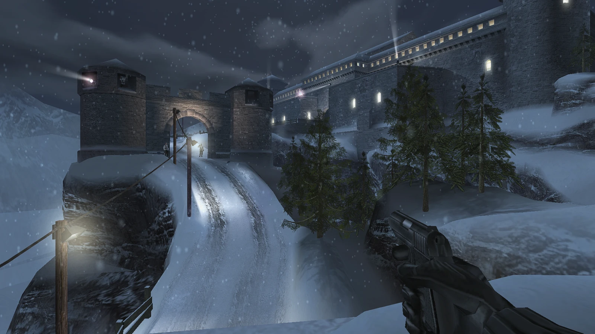
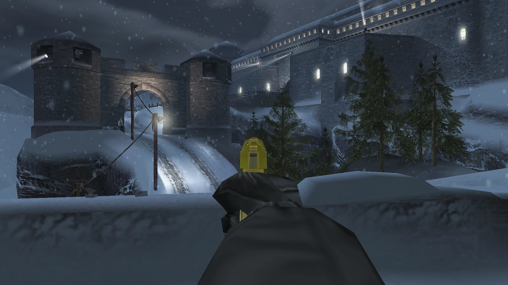
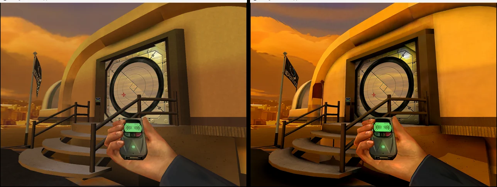
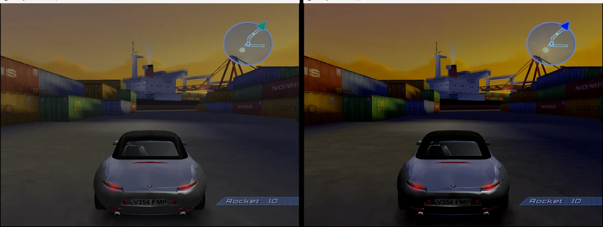
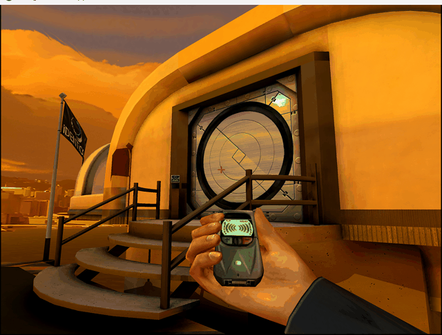
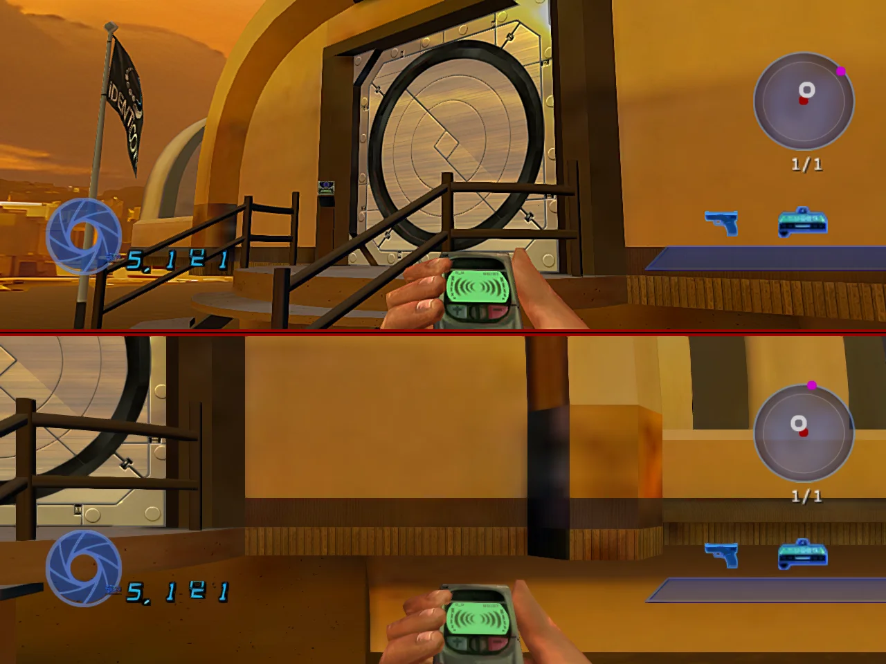

# 007 Remastered

Two Xbox Bond games, running natively on PC from one launcher:

- **007: NightFire**, remastered: ray traced lighting, sharper and richer graphics, HD textures, story co-op, LAN
  multiplayer, a modern menu and full mouse, keyboard, controller and steering wheel support. For **Windows**, with
  **Linux**, **macOS** and **Android** in beta.
- **007: Agent Under Fire** (new): aim down sights, story co-op and LAN multiplayer. For **Windows**, with
  **Linux**, **macOS** and **Android** in beta. See [Agent Under Fire](#007-agent-under-fire).

Everything is set from the games' own menus.

*The Exchange in each look: Original, Enhanced with ray traced lighting, Toon and Noir.*

<table>
<tr><td></td>
<td></td></tr>
</table>

*Fresh gameplay captures: a snowy fortress and per-weapon aim-down-sights.*

<table>
<tr><th>Original</th><th>Remastered</th></tr>
<tr><td></td>
<td></td></tr>
<tr><td></td>
<td></td></tr>
<tr><td></td>
<td></td></tr>
</table>

*The Exchange at night in the snow, Phoenix Fire in Tokyo, and Night Shift's garage.*

*Story co-op in split screen.*

> [!NOTE]
> No game files are included. You play it from your own copy of the game (the European or US Xbox disc).

## Features

**Graphics**
- **Ray tracing** (RTX-class graphics cards): real lamps and sunlight with true shadows, light bouncing off walls and
  floors, light shafts through windows, reflections and soft shadows in corners.
- **HD textures:** your own copy's textures upscaled 4x by AI on your PC, with optional bumpy, glossy surfaces and
  stones and mortar that stand out.
- **Graphics styles:** Original, Enhanced, Toon, Retro and Noir, switched live from the menu.
- **Explosions and gunfire:** sparks that bounce, flying debris, dust, rising smoke and fireballs.
- **Water:** waves, reflections of the lights, see-through water that darkens with depth, and foam at the edges.
- **Snow:** falling snow, blizzards and footprints that fill in again; snow that sparkles.
- **More detailed ground and walls:** real lumps and hollows in grass, snow, rock and concrete.
- **HDR lighting:** bright snow and lamps glow instead of turning flat white; HDR on HDR screens.
- **Smooth edges:** TAA, SMAA, FXAA and MSAA, plus **FSR 2** and **NVIDIA DLSS** (RTX graphics cards) for more
  frames per second, and **DLAA** for the smoothest edges at full sharpness.
- **Effects:** ambient occlusion, contact shadows, bloom, ice and wet-floor reflections, light from muzzle flashes
  and fire, fog, depth of field, optional motion blur and blood that stays: dark red stains on the floor and walls
  where you hit someone.
- **Ragdolls** (optional, Gameplay & More): enemies go limp when they die and fall with the shot, onto the ground
  and against walls, instead of the death animations.
- **Movies** upscaled sharp, in 4:3 or stretched.
- **Any resolution, ultrawide** screens, field of view, vsync and a frame rate cap.
- Crisp text and HUD at high resolutions, and today's Xbox button pictures.

*Water in Phoenix Base, and an explosion with sparks, debris and smoke in The Exchange.*

**Sound**
- **3D sound** (on by default, Gameplay & More): sounds come from their direction and are duller behind you,
  muffled through walls, and echo indoors by the size of the room.

**Controls**
- **Mouse aiming** like a PC shooter, with the keyboard's keys shown in the game's prompts.
- **Aim down sights**, each weapon's sights lined up on the centre (the scoped weapons keep their scopes), sprint,
  hold-to-crouch, keys 1-9 for weapons, weapon sway and hit markers.
- **Crosshairs** of your own (dot, cross, ring, cross and dot) in six colours and three sizes, and **Hit Effects**:
  red edges and a shake when you are hurt, damage numbers on your hits, or both.
- Every key rebindable in the game's **Key Bindings** page.
- Xbox, PlayStation and Switch **controllers**, with rumble.
- **Touch controls** on a touch screen (Windows): an on-screen stick, buttons and look, turned on under the F1
  settings window's **On-screen touch controls**. Android always has them.
- **Tighter Movement** (Controls, Gameplay; off by default): firmer on-foot jumps and falls, and quicker grenades,
  for a snappier feel. In multiplayer the host sets it for everyone.
- **Steering wheels**, pedals, shifters and button boxes in the driving missions, with force feedback, set up in the
  game's **Steering Wheel** page.

**Play together**
- **Story co-op:** play the missions with a friend, in split screen or over the network, with saves and unlocks as
  normal; friendly fire on or off.
- **Network co-op:** the host's address is shown in the game; friends on your network find the game by themselves.
- **LAN multiplayer:** host or join matches on your network, with AI bots, teams and drop-in play.
- Split screen with the keyboard and mouse as a player of their own.

**Menus and more**

*The modern menus: the main menu, the pause screen and its tabs, and choosing a multiplayer map.*

- **Modern menus:** every menu redrawn in the blues of the PS2 cover, made for the mouse. The classic menus are one
  setting away.
- All settings in the game's own menus, under Settings in the main menu and the pause screen.
- **Achievements:** 19, with pop-ups and their own page in More Settings showing what you have unlocked and how
  close you are to the medal ones (see [ACHIEVEMENTS.md](ACHIEVEMENTS.md)).
- **Photo mode:** pause and pick Photo Mode (or press F10), then fly the camera anywhere nearby with the mouse and
  WASD or a controller, change the field of view, exposure, depth of field and look, and take the shot without the HUD.
- **Screenshots:** F12 saves a PNG in the Screenshots folder next to the game.
- **Performance overlay:** FPS, a frame time graph, GPU time and the render resolution in a corner panel.
- **Quick restart:** Restart on the pause screen restarts the mission at once, and you can bind a key for it.
- **Discord status:** shows the mission you are playing (add your Discord application ID in the launcher).
- Adjustable aim-down-sights zoom, and one button to reset every setting to its default (your keys and saves stay).
- Characters' feet stand on slopes and steps; START at the title can go straight to the menus; Hide HUD for
  screenshots.
- Both the European and US discs, on foot and the driving missions.

## 007: Agent Under Fire

The original Xbox 007: Agent Under Fire, running natively on PC, in the same launcher as NightFire. **Windows**,
with **Linux**, **macOS** (untested) and **Android** (untested on a phone) in beta. The launcher builds it from your
European (PAL) disc; the US disc is not supported in the launcher yet.

*Original graphics (left) and Ultra (right): ray traced lighting, Enhanced colour, HD textures and 2x resolution.*

*The same comparison on the docks driving mission.*

*Ultra with each shader style in turn: Enhanced, Toon, Retro and Noir.*

*Story co-op in split screen.*

**Features**
- Vulkan renderer with ray tracing, widescreen, any resolution and high frame rates.
- Aim down sights, mouse and keyboard on foot, driving and on the guns, and controllers.
- Story co-op in split screen or over the network.
- LAN multiplayer with everything unlocked.
- Modern menus, PC settings in the game's menus, ragdolls, 3D sound, photo mode and achievements.
- English, French and German.

## The launcher

The **007 Remastered launcher** sets up both games, each on its own tab (Agent Under Fire on Windows):
- **Mission:** choose your disc image and press **Install**: the launcher builds the game on your PC from your own
  disc. Then **Play**, and **Update** when a new version is out. Nothing is installed in Windows.
- **Settings:** every option, also outside the game.
- **HD Textures:** collect every texture with one button (no playing needed), or as you play, then make your HD pack
  with one click.
- **Your music:** a folder of your songs becomes the game's soundtrack.

**Download** it from the [latest release](https://github.com/papand7/nightfire-recomp/releases/latest):
- **Windows:** `007Remastered.exe`. Just run it.
- **Linux (beta):** `007Remastered-x86_64.AppImage`. Make it executable (`chmod +x`) and run it. If your system
  is missing something the game needs, the launcher tells you the one command to install it. It needs a graphics card
  with Vulkan (Mesa or NVIDIA drivers). HD texture packs work; DLSS is Windows-only for now.
- **macOS (beta, Apple Silicon only):** `007Remastered-macOS-arm64.dmg`. Open it and drag the launcher to
  Applications. It is not signed, so the first time right-click it and choose **Open**. This is the first macOS
  build: the launcher installs CMake and Ninja itself and asks macOS for Apple's command line developer tools
  (**Install the requirements**). The game draws with Vulkan through MoltenVK, shipped with it, and its shaders
  compile through glslang. The first report from a Mac (a crash at start on Apple Silicon's 16 KB memory pages) is
  fixed; expect more problems and please report them with the game's log. Ray tracing and DLSS are off on the Mac;
  the HD texture pack tool is built but untested.

- **Android (beta, NightFire and Agent Under Fire):** `NightFire-Android.apk` (the app is named 007), sideloaded. The game itself is built on your PC: in the
  Windows or Linux launcher's **Android** page choose **Build Android package**, copy the zip to the phone and import
  it in the app. Each game's package is kept apart; the game tabs at the top pick the one to play.

Building it yourself instead: see [BUILDING.md](BUILDING.md).

## Credits

- **The original PC ports,** [hk21x/nightfire-recomp](https://github.com/hk21x/nightfire-recomp) and
  [hk21x/007-agentunderfire-recomp](https://github.com/hk21x/007-agentunderfire-recomp) by Harry, which this project
  started from.
- **The recompiler,** [TGP482/XboxXBE-Recomp](https://github.com/TGP482/XboxXBE-Recomp) by TGP482.

## License

MIT: see [LICENSE](LICENSE). 007: NightFire and 007: Agent Under Fire are the property of their owners; this project
contains none of the games' code or files.
