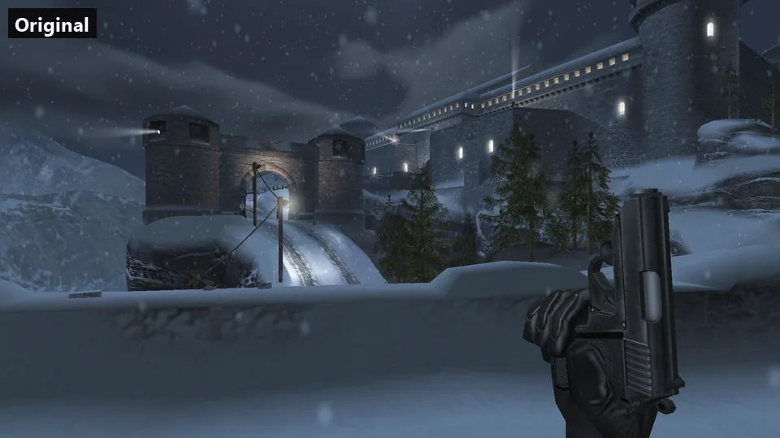
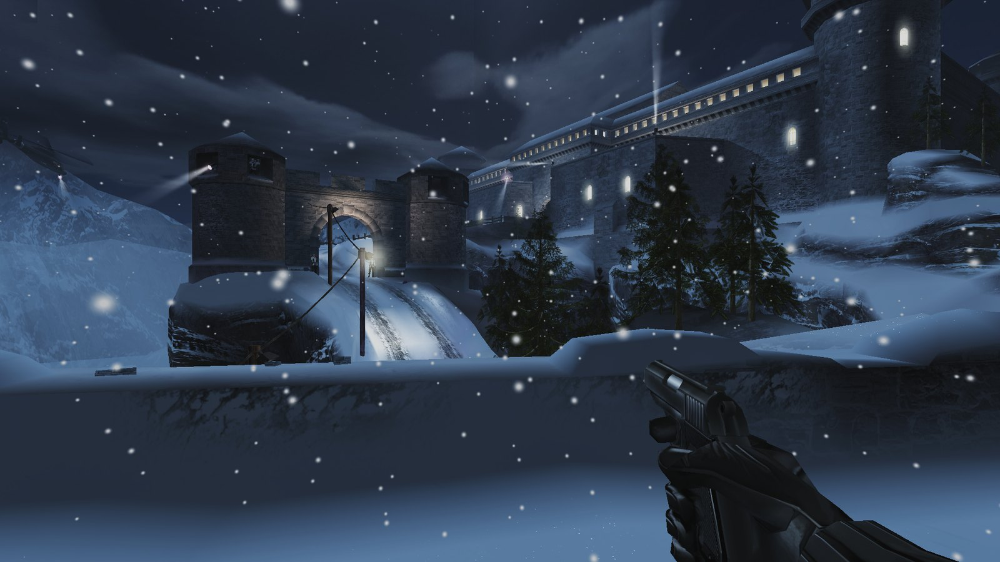
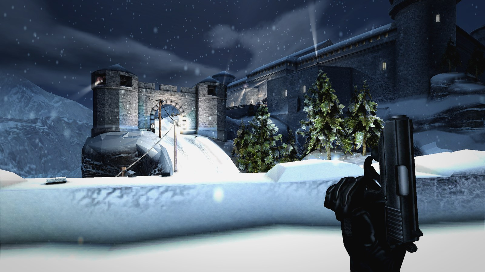

# 007: NightFire - XBE Recomp: Remastered (fork)

A fork of [hk21x/nightfire-recomp](https://github.com/hk21x/nightfire-recomp), the native PC port of the original Xbox
007: NightFire, built on its runtime fork [hk21x/XboxXBERecomp](https://github.com/hk21x/XboxXBERecomp) (from
[TGP482/XboxXBE-Recomp](https://github.com/TGP482/XboxXBE-Recomp)). All credit for the port itself, the recompiler and
the reverse engineering it stands on goes to those projects: see the
[original README](https://github.com/hk21x/nightfire-recomp#readme) for the port, its supported game versions,
controls and troubleshooting. This fork adds a Vulkan renderer with ray tracing, remaster-style graphics, HD texture
packs, LAN multiplayer and more PC controls, all chosen in the game's own menus.



*The Exchange's first view in each look: Original (no visual changes), Enhanced with ray traced lighting, Toon and
Noir. Same build; only the Graphics menu changed.*

<table>
<tr><th>Original (no visual changes)</th><th>Remastered (Enhanced style, ray traced lighting and effects)</th></tr>
<tr><td></td>
<td></td></tr>
</table>

> [!NOTE]
> Like the original project, this fork contains **no game files**, and no textures made from them. You build and play
> it from your own legally acquired copy of the game. The screenshots above are of the author's own copy.

## What's new in this fork

**Renderer and graphics**
- **Vulkan renderer** (`renderer = "vulkan"`), alongside the original's Direct3D 12 and 11.
- **Ray tracing** on RTX-class GPUs (Vulkan ray queries):
  - **Full Lighting:** the level's baked light is replaced by the game's own lamps, each with traced shadows. Outdoors
    there is a sun with traced shadows, in a random place for each level, its colour taken from the level's own light.
  - Ray traced **reflections** and **ambient occlusion**, plus shadows from effect lights. The gun and hands are traced too.
- **HD texture packs** made on your own PC from your own copy:
  - The game's textures are dumped as it plays, then `hd_pack.exe` **upscales them 4x with Real-ESRGAN** (any Vulkan
    GPU, no install), seamless on repeating textures. The game draws the pack in place of its textures.
  - **PBR materials:** `hd_pack --pbr` adds normal and roughness maps. The renderer draws bumped, glossy surfaces from
    them, and smooth surfaces reflect.
  - **Relief:** parallax occlusion mapping makes mortar sink and stones stand out.
- **Graphics styles**, live from the menus: **Original**, **Enhanced** (filmic tone mapping, grading, sharpening),
  **Toon** (cel shading and ink outlines), **Retro** (pixels, dithering, vertex snapping) and **Noir** (black, white
  and red only), plus modded presets.
- **Effects:** ambient occlusion, bloom, screen-space reflections, soft particles, light from flashes and fire,
  bounced light, fog, ground detail up close, and depth of field (Distance or Focus).
- **Blood** (optional, every style): a spray where your shots hit, and blood at the edges of your view when you are hit.
- **Quality presets** (Low to Ultra), anisotropic filtering, SMAA / FXAA / MSAA, sharpening, and render scale from 50% to 200%.

**Gameplay and controls**
- **Aim down sights:** right mouse raises the gun and zooms in instead of the red crosshair. Each weapon's sights are
  aligned, and an optional focus blur softens the background.
- **Sprint** (Shift, or a controller's left stick click; the original has none) and **hold-to-crouch** on the keyboard.
- **Key Bindings page** in the game's own menus: rebind every action to any key or mouse button.
- **Keys 1-9** pick a weapon. Subtle **weapon sway** and head bob.
- **Hit markers** on the crosshair when your shots land.
- The menu mouse fixed for hidden rows, the wheel, and rows it could not reach.

**Multiplayer**
- **LAN play** over the network (Netplay in the main menu): host or join games found on your network, with a lobby,
  names and teams. The host's AI bots play in network games, players can join mid-match, and a bot takes a leaver's place.
- "Keyboard alone": in split screen the keyboard and mouse play as a player of their own.

**Menus**
- **Graphics**, **Effects**, **Style Options**, **More Settings**, **Netplay** and **Key Bindings** pages, drawn in
  the game's own menu style, under Settings in the main menu and the pause screen.
- **Start in Menus:** START at the title opens the menus instead of the Paris mission.
- Blue PC-style menu backgrounds (optional); the game's own font, redrawn sharp at high resolutions.

## Building

**You need:** Windows 10 or 11 (64 bit), [Git](https://git-scm.com/download/win), Visual Studio 2022 (Community is
fine) with **Desktop development with C++** (`build.bat` offers to add the Clang and CMake tools), about 3 GB free,
and your own copy of the game (PAL or USA: the disc's files or its `.iso`). For the Vulkan renderer, a GPU with
Vulkan 1.3; for ray tracing, one with ray queries (RTX-class).

1. Clone this repository with its runtime:
   ```
   git clone --recurse-submodules https://github.com/papand7/nightfire-recomp.git
   cd nightfire-recomp
   ```
2. Put your game files in `assets`: `assets\default.xbe` with `Driving.xbe` and the game's folders beside it, or your
   disc's `.iso`.
3. Run `build.bat`. The first build recompiles both programs and takes a while; later builds are quicker.
4. Run `out\build\release\Nightfire.exe`, then choose **Renderer: Vulkan** in Settings > Graphics and restart.

The original project's launcher builds the original, not this fork.

**HD textures:** turn on *Dump the game's textures* (F1 > Graphics Style > Textures), play the levels you want
upgraded, then run `tools\hd_pack.exe --pbr` beside the game and restart it. See
[docs/graphics_styles.md](docs/graphics_styles.md#hd-texture-pack-hd_pack). Dumped and upscaled textures are the
game's: keep them out of any public repository.

## License

MIT, as the original: see [LICENSE](LICENSE). 007: NightFire is the property of its owners; this project contains
none of the game's code or assets.
