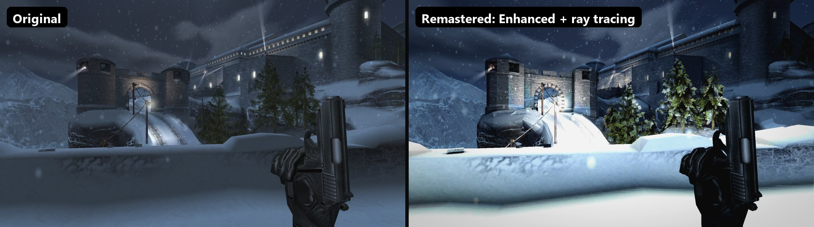

# 007: NightFire - XBE Recomp: Remastered (fork)

A fork of [hk21x/nightfire-recomp](https://github.com/hk21x/nightfire-recomp), the native PC port of the original Xbox
007: NightFire, built on its runtime fork [hk21x/XboxXBERecomp](https://github.com/hk21x/XboxXBERecomp) (from
[TGP482/XboxXBE-Recomp](https://github.com/TGP482/XboxXBE-Recomp)). All credit for the port itself, the recompiler and
the reverse engineering it stands on goes to those projects. This fork adds a Vulkan renderer with ray tracing,
remaster-style graphics, LAN multiplayer and more PC controls, all chosen in the game's own menus.



<table>
<tr><th>Original (no visual changes)</th><th>Remastered (Enhanced style, ray traced lighting, every effect)</th></tr>
<tr><td></td>
<td></td></tr>
</table>

*The Exchange, the mission's first view. Same frame, same build; only the Graphics menu changed.*

> [!NOTE]
> Like the original project, this fork contains **no game files**. You build and play it from your own legally
> acquired copy of the game. The screenshots above are of the author's own copy.

## What's new in this fork

**Renderer and graphics**
- **Vulkan renderer** (`renderer = "vulkan"`), alongside the original's Direct3D 12 and 11.
- **Ray tracing** on RTX-class GPUs (Vulkan ray queries):
  - **Full Lighting:** the level's baked light is replaced by the game's own lamps, each with traced shadows. Outdoors
    there is a sun with traced shadows, in a random place for each level, its colour taken from the level's own light.
  - Ray traced **reflections** and **ambient occlusion**, plus shadows from effect lights. The gun and hands are traced too.
- **Graphics styles**, live from the menus: **Original**, **Enhanced** (filmic tone mapping, grading, sharpening),
  **Toon** (cel shading and ink outlines), **Retro** (pixels, dithering, vertex snapping) and **Noir** (black, white
  and red only), plus modded presets.
- **Effects:** ambient occlusion, bloom, screen-space reflections, soft particles, light from flashes and fire,
  bounced light, fog, ground detail up close, HD texture packs with PBR materials, and depth of field (Distance or
  Focus).
- **Blood** (optional, every style): a spray where your shots hit, and blood at the edges of your view when you are hit.
- **Quality presets** (Low to Ultra), anisotropic filtering, SMAA / FXAA / MSAA, sharpening, and render scale from 50% to 200%.

**Gameplay and controls**
- **Aim down sights:** right mouse raises the gun and zooms in instead of the red crosshair. Each weapon's sights are
  aligned, and an optional focus blur softens the background.
- **Sprint** (Shift; the original has none) and **hold-to-crouch** on the keyboard.
- **Key Bindings page** in the game's own menus: rebind every action to any key or mouse button.
- **Keys 1-9** pick a weapon. Subtle **weapon sway** and head bob.
- **Hit markers** on the crosshair when your shots land.
- The menu mouse fixed for hidden rows, the wheel, and rows it could not reach.

**Multiplayer**
- **LAN play** over the network (Netplay in the main menu): host or join games found on your network, with a lobby,
  names and teams. The host's AI bots play in network games, players can join mid-match, and a bot takes a leaver's place.
- "Keyboard alone": in split screen the keyboard and mouse play as a player of their own.

**Menus**
- **Graphics**, **Effects**, **Style Options**, **More Settings**, **Netplay** and **Key Bindings** pages, drawn in
  the game's own menu style, under Settings in the main menu and the pause screen.
- **Start in Menus:** START at the title opens the menus instead of the Paris mission.
- Blue PC-style menu backgrounds (optional); the game's own font, redrawn sharp at high resolutions.

## Building this fork

As in the original instructions below, but clone this repository:

```
git clone --recurse-submodules https://github.com/papand7/nightfire-recomp.git
```

The `sdk` submodule points at this fork's copy of the runtime (the Vulkan renderer lives there). The launcher
described below builds the **original** project, not this fork. To get the remastered features, build from source
with `build.bat`, then choose **Renderer: Vulkan** in Settings > Graphics and restart.

---

*The original project's README follows.*

# 007: NightFire - XBE Recomp


An unofficial native PC port of the original Xbox version of 007: NightFire, with extended graphics options and other
enhancements. The game's own x86 code is statically recompiled into Windows executables with the
[Xbox XBE Recomp](https://github.com/TGP482/XboxXBE-Recomp) tool; the Xbox's graphics, sound and system libraries are
reimplemented for Windows (Direct3D 12 or 11, XAudio2, SDL). It is not an emulator.

> [!NOTE]
> This project does not include any game assets. You must provide the files from your own legally acquired copy of
> the game to build and play.

## Supported Versions

The European (PAL) and North American (NTSC) Xbox releases of 007: NightFire (title id 45410026):

| Release | `default.xbe` (on foot, menus) | `Driving.xbe` (the driving missions) |
| --- | --- | --- |
| Europe (PAL; also the En, Fr, De, Es, It, Nl, Sv disc) | `796222e048be3595c323b4c6d9795107132dc4ca` | `e0c41209d8979fcd03ac3d656be78759006023cb` |
| USA (NTSC) | `7e4b8f8a54bacc61a5897ba5245fdd65bddc0752` | `8d46a023dfbd5c89d4ee04fe28b24a9620de546a` |

The two releases run the same code (their xbes differ only in the signature and certificate); each plays its own
movies (25 or 30 frames a second) and files, as on a console of its region. The game is two programs: the driving
missions (Paris Prelude, Alpine Escape, Enemies Vanquished, Deep Descent, Island Infiltration) are a second xbe that
the game launches and returns from. Both are recompiled, into `Nightfire.exe` and `NightfireDriving.exe`, and the
switch between them happens on its own. The log names the SHA-1 of each xbe it found. Other releases have not been
checked.

## Getting Started

There are two ways to get the game running. Both build it on your own PC from your own disc: the game's code is
never downloaded, only the tools and this project's source.

### The launcher (recommended)

`NightFireLauncher.exe` does everything for you: no Visual Studio, no Git, no command line, nothing installed in
Windows and no admin rights needed.

**You need:**
- Windows 10 or 11, 64 bit, and a GPU with Direct3D 12 or Direct3D 11.
- Your own copy of the game (PAL or USA): an `.iso` image of your disc, or a folder with the disc's files.
- About 3 GB free, plus room for your copy of the game, and an internet connection for about 1.4 GB of build tools.
  Your copy takes 7.3 GB when the launcher has to copy your disc image, which it does from another drive or on a drive
  such as exFAT; nothing more when it can link to the image on the same NTFS drive, or to a folder of the disc's files.

**Steps:**
1. Download `NightFireLauncher.exe` from the [latest release](https://github.com/hk21x/nightfire-recomp/releases/latest).
2. Put it in a folder of its own (for example `C:\Games\NightFire`) and run it. Everything it makes goes in a
   `NightFire` folder beside it. Windows may warn about an unrecognised app: choose **More info**, then **Run anyway**.
3. **Your game:** choose your disc image or the folder with the disc's files. The launcher checks that it is the
   supported release.
4. **Build:** accept the license terms for Microsoft's C++ libraries and Windows SDK (the build uses them), then press
   **Build**. It downloads portable build tools (Clang, CMake, Ninja, Git and Microsoft's libraries), this project's
   source, and builds the game. The first build takes 30 to 90 minutes. You can stop it at any time; it carries on
   where it left off.
5. **Play:** press **Play**.

When this project is updated the launcher shows **Update**: press it, then Play.

Files, all under the `NightFire` folder beside the launcher:
- `play\` the game: `Nightfire.exe`, `NightfireDriving.exe`, `settings.toml`, `hdd\` (saves), `logs\` (the game's logs)
- `launcher.log` the launcher's log (send it with any problem building)
- `tools\` and `source\` the build tools and the source

To remove everything, delete the launcher and its `NightFire` folder (keep `play\hdd` if you want your saves).

### Building from source (developers)

**You need:** Windows 10 or 11 (64 bit), [Git](https://git-scm.com/download/win), Visual Studio 2022 (Community is
fine) with **Desktop development with C++** (`build.bat` offers to add **C++ Clang tools for Windows** and **C++ CMake
tools for Windows**), about 3 GB free, plus room for your copy of the game, and your disc's files: `default.xbe`, `Driving.xbe` and the game's folders.

1. Clone the repository with its SDK:
   ```
   git clone --recurse-submodules https://github.com/hk21x/nightfire-recomp.git
   cd nightfire-recomp
   ```
   Cloned without `--recurse-submodules`? Run `git submodule update --init`.
2. Put your game files in the `assets` folder: `assets\default.xbe` with `Driving.xbe` and the game's folders
   (`eurocom`, `driving` ...) beside it, or your disc's `.iso`.
3. Run `build.bat`. The first build recompiles both xbe files and takes 30 to 90 minutes; later builds are quicker.
4. Run `out\build\release\Nightfire.exe`. It finds the `assets` folder beside itself or in any folder above it.

`launcher.bat` builds `NightFireLauncher.exe` itself. Files the game writes beside the exe: `settings.toml`, `hdd\`
(saves; delete it to start again from a first boot), `logs\`, `shadercache.bin` (compiled shaders) and `CrashDumps\`
if it crashes.

## Controls and Settings

**Settings:** in the game's own menus, as the main menu's **Settings** item and a choice on the on-foot pause
screen (under Continue, Restart and Quit): field of view, mouse sensitivity and invert, skip intro, sharp 2D, aspect,
display mode, resolution, vsync and frame cap. **F1** opens the full settings window (graphics, renderer, controls) at
any time; changes are saved at once to `settings.toml`.

**Keyboard and mouse on foot** (remappable in the settings window's Controls tab, two keys per input):

| Action | Keys |
| --- | --- |
| Move and strafe | W A S D |
| Look and aim | Mouse (free aim: no lock-on while the mouse plays) |
| Fire / manual aim | Left / right mouse button |
| Action, reload | E, R |
| Jump | Space |
| Crouch | C or Left Ctrl |
| Next weapon | 1, the mouse wheel (in a scope it zooms), or the right arrow (left arrow or 3: the one before) |
| Next weapon (another) | Q |
| Alt. fire | Middle mouse button or F |
| Next gadget | 2 or G |
| Gadget / zoom | Up and down arrows |
| Vision mode | V or Tab |
| Pause | Esc or P |

With a scope or a launcher the mouse turns at a quarter of its speed; through a scope the mouse wheel zooms in and
out. A guided missile steers with the mouse. Keypads (door codes) take the left mouse button or Enter. In the menus
the mouse wheel scrolls, Enter selects and Backspace goes back.

**Driving missions** have a layout of their own (rebound apart from the on-foot keys):

| Action | Keys |
| --- | --- |
| Gas / brake and reverse | W / S |
| Steer | A / D, or the left and right arrows |
| Pitch up / down (Deep Descent) | Up / down arrows, or Left Shift / Left Ctrl |
| Fire weapon | Left mouse button or Enter |
| Gadget | Right mouse button or E |
| Handbrake | Space |
| Weapons | Mouse wheel, Q / Z, or 1 to 4 |
| Camera | C |
| Look back | V or middle mouse button |
| Pause | Esc or P |

On the mounted guns (the Paris van, Alpine Escape's snowmobile turret) the mouse aims, the left button fires, the
right button zooms and R reloads.

**Controllers:** Xbox, PlayStation and Switch controllers, with hot plugging and rumble.

<p align="center">
  
  <br>
  <i>The game's text redrawn from Sour Gummy Black, with Settings on the pause screen and your keys in the prompts.</i>
</p>

## Graphics settings

In the settings window (F1, Graphics). These are shots of one spot at 3440x1440, taken one after another and lined up, so
the falling snow and the guards differ between them.

<p align="center">
  
  <br>
  <i>All off vs. a good start for a capable PC: render scale 200%, MSAA 4x, sharpening 50%.</i>
</p>

<p align="center">
  
  <br>
  <i>Edges, enlarged three times.</i>
</p>

<p align="center">
  
  <br>
  <i>The castle's windows, enlarged twice.</i>
</p>

- **MSAA** smooths the edges of the 3D scene and keeps textures sharp. The more samples, the slower.
- **FXAA** smooths the finished frame, HUD included, and softens it a little.
- **Render scale** draws the picture larger than the screen: the smoothest fine detail, and the slowest.

<p align="center">
  
  <br>
  <i>Sharpening, enlarged twice.</i>
</p>

- **Sharpening** makes the picture crisper. Around 50% is a good start; 100% turns stone walls gritty.

## Features

### Display
- **Display Modes** - Fullscreen, borderless window or window, at any resolution the monitor offers.
- **Widescreen** - The game's own 16:9 mode on a widescreen display.
- **Ultrawide** - With `aspect = "screen"`, the 3D view widens to fill a 21:9 or wider screen, on foot and in the
  driving missions; the HUD and menus keep their 16:9 shape in the centre, and the sniper scope's black surround
  reaches the screen's sides.
- **Field of View** - `fov_percent` (50 to 150, 100 the game's) widens or narrows the view on foot, driving and in
  the engine's cutscenes; the scope zooms in proportion.
- **Frame Rate** - Vsync, a frame rate cap and an FPS counter.

### Graphics
- **Render Scale** - Renders at a percentage of the screen.
- **Anisotropic Filtering**, **MSAA**, **FXAA** and **Sharpening** - See [Graphics settings](#graphics-settings).
- **Clean Fonts** - The game's text, in both xbes, is redrawn at eight times the console's resolution from
  [Sour Gummy Black](https://fonts.google.com/specimen/Sour+Gummy), a close match for the game's own face, so it stays
  smooth at any resolution.
- **Modern Button Pictures** - A controller's prompts show today's Xbox pad: A B X Y in the modern style, LB and RB for
  the White and Black buttons, LT and RT, and the Menu and View buttons for Start and Back (`modern_buttons`, on by
  default).
- **Sharp Text and HUD** - The menus' and HUD's pictures are enlarged with sharp edges for high resolutions
  (`sharp_2d`, on by default).
- **Shader Cache** - Compiled shaders are kept in `shadercache.bin`, so each is compiled once rather than in every
  session, and later sessions do not stutter while they compile.

### Keyboard and Mouse
- **Mouse aiming** - The mouse turns the view and aim directly, like a PC shooter (not through the stick's curve),
  with sensitivity and invert options, and with no auto-aim while it plays. The driving missions' mounted guns aim
  with it too.
- **Keyboard prompts** - While you play on the keyboard and mouse, the game's button pictures (tutorials, menus, the
  controls pages, both xbes) show the keys and mouse buttons bound to them; they switch back when you pick up the
  controller.
- Every key and mouse button can be rebound in the settings window (F1, Controls tab).

### General
- **Launcher** - `NightFireLauncher.exe`: choose your disc, Build, Play, Update; portable build tools, nothing
  installed.
- **Settings in the game's menus** - A native page in the game's own menus, from the main menu and the pause
  screen (see above).
- **Achievements** - 19 achievements (every mission, medals, 00 Agent, Bond Moves) with pop-ups and a list in the
  settings window, written in RetroAchievements' condition format; the set and its memory map are in
  [ACHIEVEMENTS.md](ACHIEVEMENTS.md).
- **Hide HUD** - Clears the HUD on foot and in the driving missions, for screenshots (`hide_hud`, F1; at once). The
  pause screens and menus stay.
- **Quit Game** - The main menu has a Quit Game item, and the settings window (F1) has a Quit game button.
- **Skip Intro Movies** - `skip_intro = true` starts without the EA and MGM logo movies.
- **Saves** - Kept on an emulated hard disk beside the exe.

### Miscellaneous
- **Boot Splash** - Place a `splash.png` (or `.bmp`) beside the exe to display a splash screen at launch.
- **Diagnostics** - Logs in `logs\`, and frame captures (F3, with `XBE_CAPTURE_DIR` set).

## Status

Plays on foot and in the driving missions on Windows, with saves; mouse aiming, the keyboard prompts, modern button
pictures, clean fonts, Settings (main menu and pause screen), Hide HUD, Quit Game, widescreen and ultrawide are
in. Progress is in [PROGRESS.md](PROGRESS.md), and technical findings in [FINDINGS.md](FINDINGS.md).

## Community and Support

Join the [Discord server](https://discord.gg/PQjkKsdtc) for help getting the game running, to report problems,
and to talk about the port with other players.

## Troubleshooting

- Something wrong: the first lines of the log in `logs\` list the settings, the GPU and any `XBE_*` or `NF_*`
  environment variables; leftover ones from experiments change how the game runs.
- The launcher's build failing: send `NightFire\launcher.log`. Press Build again after a network problem: it carries
  on where it stopped.
- A build failing with "permission denied" on `Nightfire.exe` or `NightfireDriving.exe`: the game is still running;
  close it and build again.
- "The game could not start NightfireDriving.exe" when a driving mission starts: the driving exe is missing. Windows
  Security may have quarantined it (Protection history: allow it on your device), or a build did not finish: build
  again with the game closed.
- A short stutter the first time a new area or effect appears: its shaders are being compiled. They are kept in
  `shadercache.bin`, so it does not happen there again.
- A first boot again: delete the `hdd` folder beside `Nightfire.exe` (`NightFire\play\hdd` with the launcher,
  `out\build\release\hdd` when built from source). This deletes your saves.

## System Requirements

- **OS** - Windows 10 or 11, 64 bit
- **GPU** - with support for Direct3D 12 or Direct3D 11 (F1, Graphics, Renderer; applies at the next start)

## License

The port's own code is under the MIT License ([LICENSE](LICENSE)); the SDK and the third-party parts under theirs
(`sdk/LICENSE`, `sdk/THIRD_PARTY.txt`, `third_party/`). The game is not included: its code is recompiled from your own
disc on your PC.

## Credits

- [Xbox XBE Recomp](https://github.com/TGP482/XboxXBE-Recomp), the recompiler and runtime this is built on.
- [XenonRecomp](https://github.com/hedge-dev/XenonRecomp) for the overridable function layout and instruction hooks.
- [Zydis](https://github.com/zyantific/zydis) for decoding x86 instructions, [toml++](https://github.com/marzer/tomlplusplus) for the configs, [Dear ImGui](https://github.com/ocornut/imgui) for the settings overlay and [SDL](https://github.com/libsdl-org/SDL) for the window, input and controllers.
- [Sour Gummy](https://github.com/eifetx/Sour-Gummy-Fonts) by the Sour Gummy Project Authors, under the SIL Open Font
  License (`third_party/fonts/OFL.txt`), and [stb_truetype](https://github.com/nothings/stb) for drawing it.
