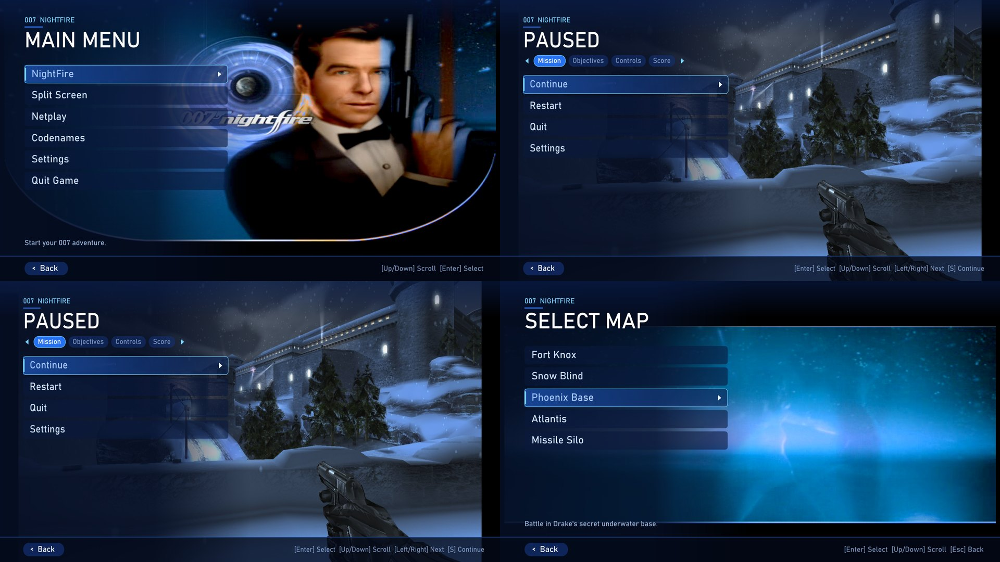
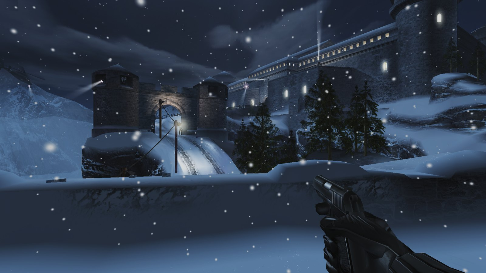
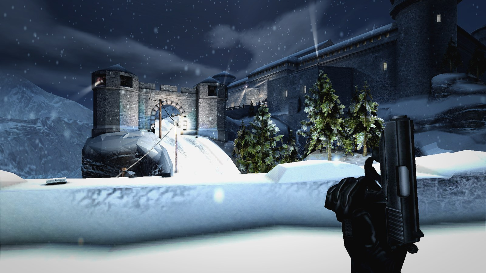
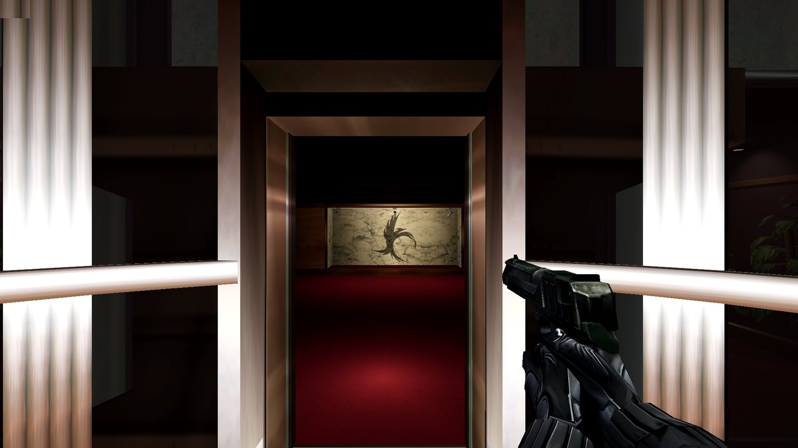
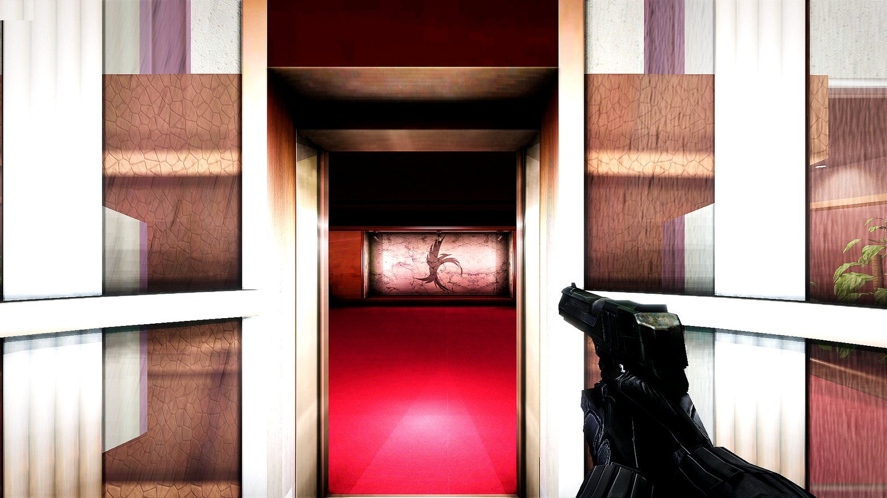
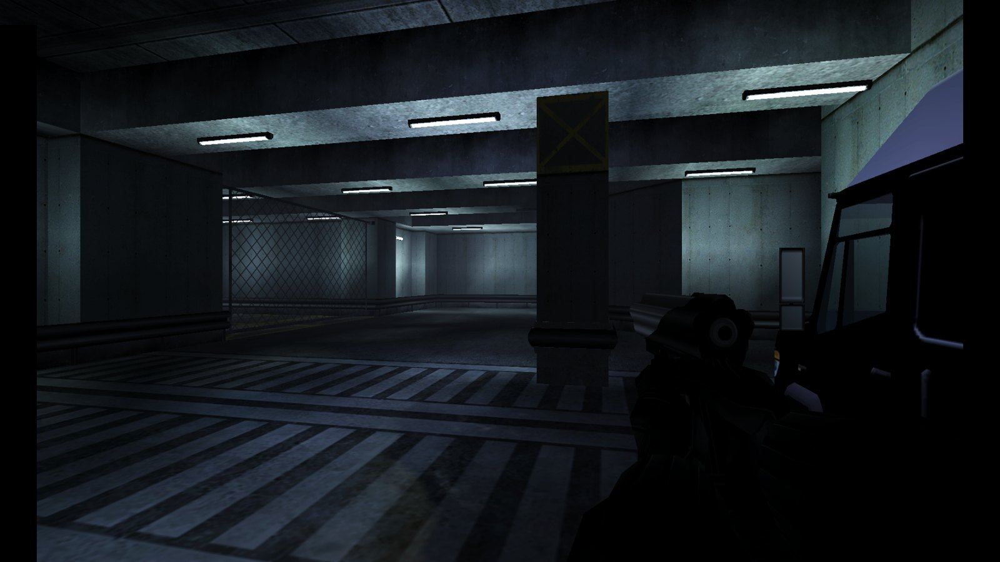
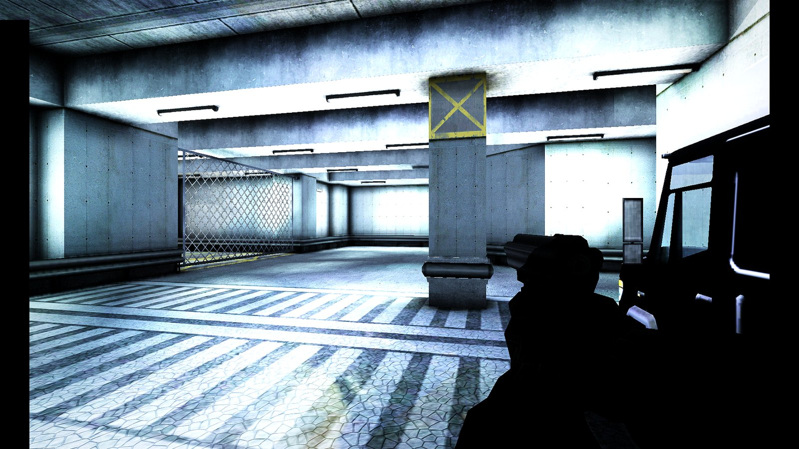
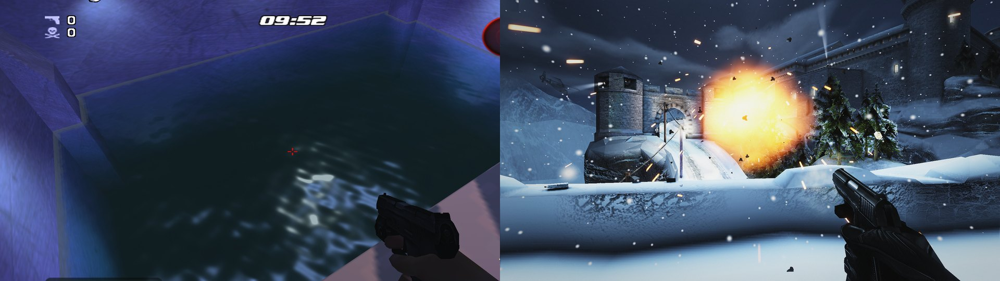
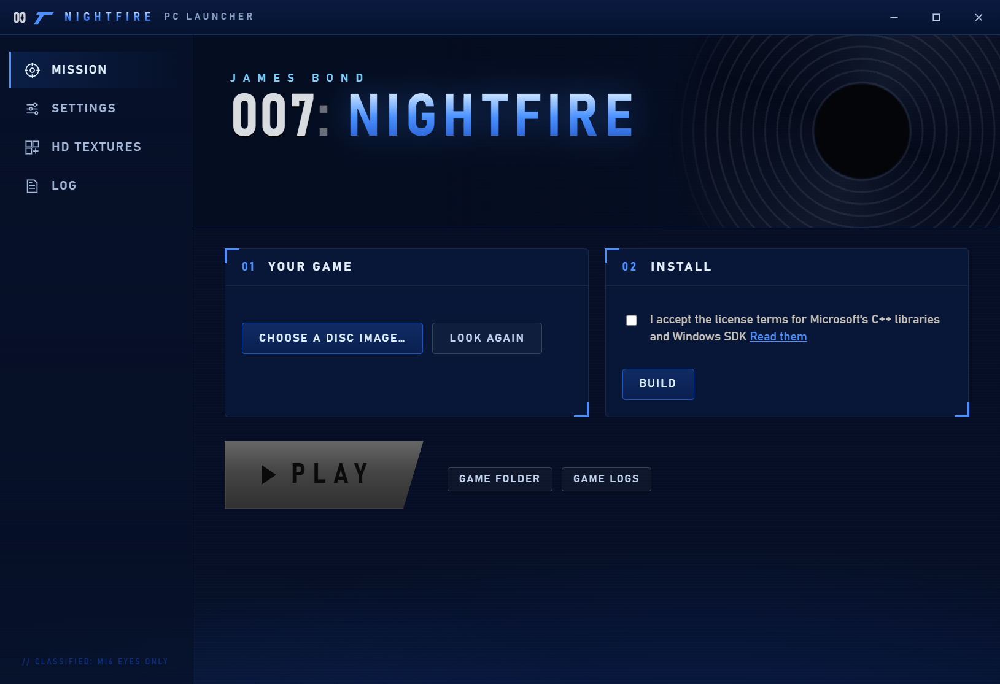

## 007: NightFire Remastered 1.3.0

A big update: a brand new menu, story co-op over the network, water, explosions with real sparks and smoke, sharper
edges and more frames per second. Download the launcher below, choose your disc and press Install (or Update).

| Original | Remastered |
|---|---|
|  |  |
|  |  |
|  |  |

### New look
- **Modern menus** (the default): every menu redrawn in the blues of the PS2 cover, made for the mouse. The pause
  screen has tabs for Mission, Objectives, Controls and Score. The classic menus are one setting away in the launcher.
- **New launcher look** in the same blues.

### Graphics
- **Water:** Phoenix Base's water now has waves, reflections of the lights, depth and foam.
- **Explosions and gunfire:** sparks that bounce, flying debris, dust, rising smoke and fireballs.
- **FSR 2 upscaling:** more frames per second (Quality, Balanced, Performance), or Native AA for the smoothest edges.
- **TAA:** smooth, steady edges with no shimmer.
- **Cleaner ray tracing:** the bounced light and light shafts are smooth instead of grainy.
- **More detailed ground and walls:** real lumps and hollows in snow, rock and concrete.
- **Movies** upscaled sharp, shown 4:3 or stretched.
- Fixes: Double Cross no longer looks orange; sunlit walls in Chain Reaction and the walls in Phoenix Fire no longer
  glow white.

### Play together
- **Network co-op:** the host's address is shown in the game; friends on your network find the game by themselves,
  or join over the internet by address.

### Controls
- **Steering Wheel** page in the game's menus: set up every axis, button and gear of your wheel, pedals and shifter.

### Settings
- Every setting is now in the game's own menus or the launcher (the F1 window is gone).
